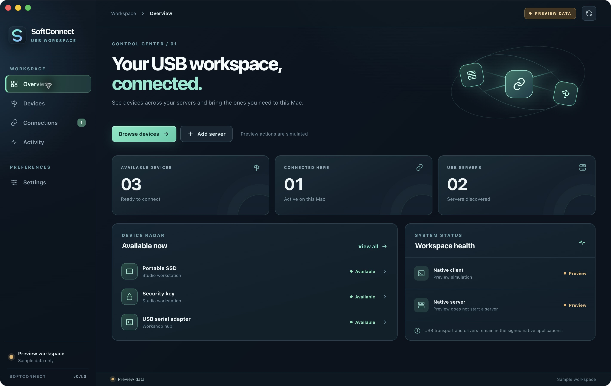

# SoftConnect

SoftConnect is a macOS desktop control center for shared USB devices. Its React interface runs inside a local Electron app, with a narrow native bridge to the [documented VirtualHere client API](https://www.virtualhere.com/client_api). There is no hosted website or localhost server.



## What it does

- Discover servers and devices through the installed native client.
- Search and filter available, connected, and occupied devices.
- Connect or release a device, inspect properties, rename it, configure auto use, and add a manual server through explicit actions.
- Show a window-local activity timeline and native integration status.
- Explore the interface in a clearly labeled Preview mode that never touches USB hardware.

SoftConnect does not bundle VirtualHere or replace its USB driver. Install and run the [official macOS client](https://www.virtualhere.com/usb_client_software) to use real USB devices. A server is needed on the machine physically holding those devices. The app detects supported install locations and keeps real device actions unavailable until the client responds.

## Download and run

Download the macOS app archive from this repository's Releases page, unzip it, and open `SoftConnect.app`. The current build targets Apple silicon. It is ad hoc signed and not notarized; macOS may require the normal manual Open flow. The app requires no browser tab or web server.

For development on macOS:

```sh
npm ci
npm test
npm start
```

To create the desktop bundle:

```sh
npm run pack:mac
```

Build output is written under `release/` and is excluded from Git. `npm run build` checks the React production bundle alone.

## Architecture and trust boundary

The Electron renderer uses context isolation and cannot invoke Node.js directly. The preload exposes only selected SoftConnect methods. The main process invokes allowlisted `-t` commands with direct arguments and bounded output; no command shell is used. Network navigation is disabled. See [architecture](docs/ARCHITECTURE.md) for the runtime boundaries and research basis.

The official macOS client has Apple's managed USB host-controller entitlement. SoftConnect does not have that entitlement and does not claim a separate virtual USB transport. Real USB attachment remains provided by the installed client. The app contains no vendor code, binaries, icons, license keys, or decompiled resources. SoftConnect is an independent interface and is not endorsed by VirtualHere.

The Preview workspace is sample data. A successful UI build or preview interaction does not prove that a physical device was attached. Real client integration must be verified with a disposable USB device before claiming device-level compatibility on a given machine.
